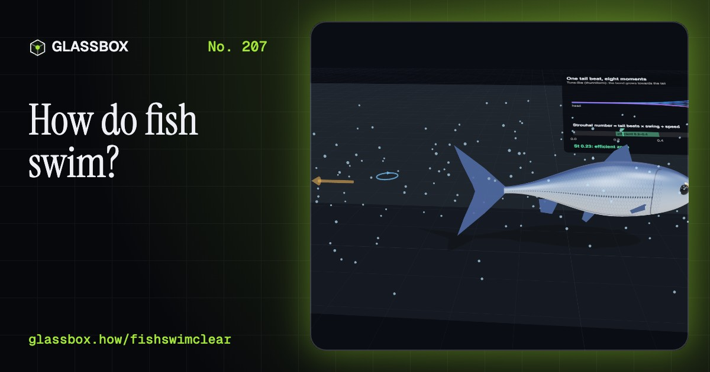
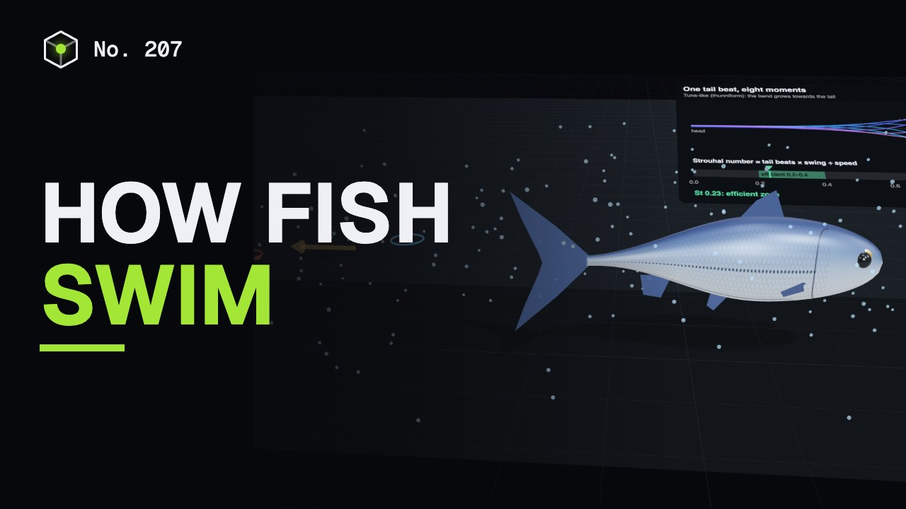
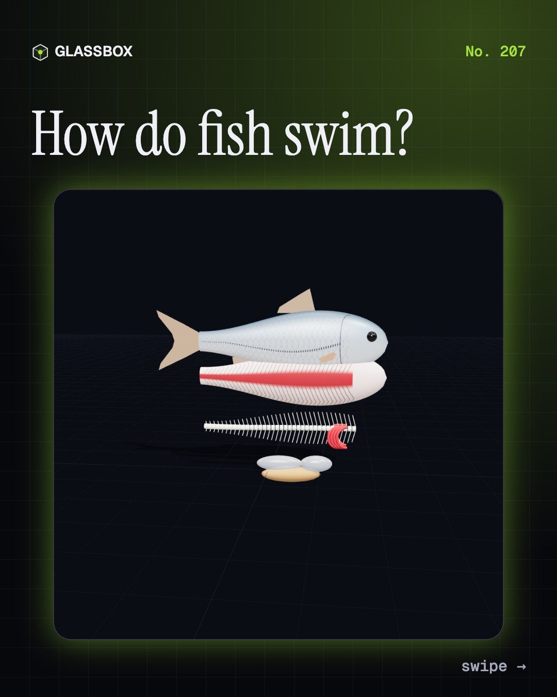
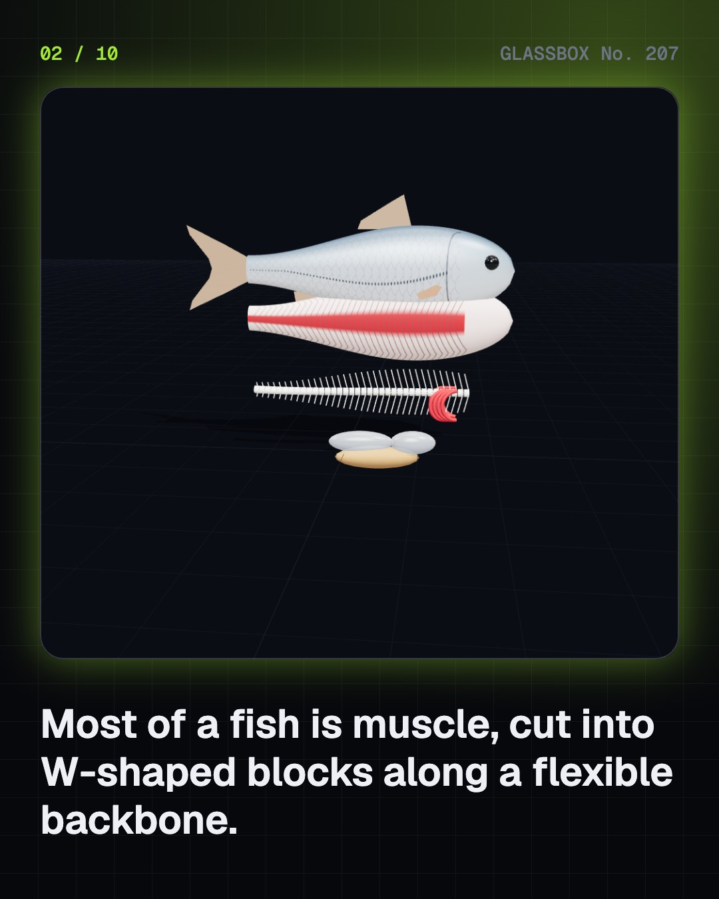
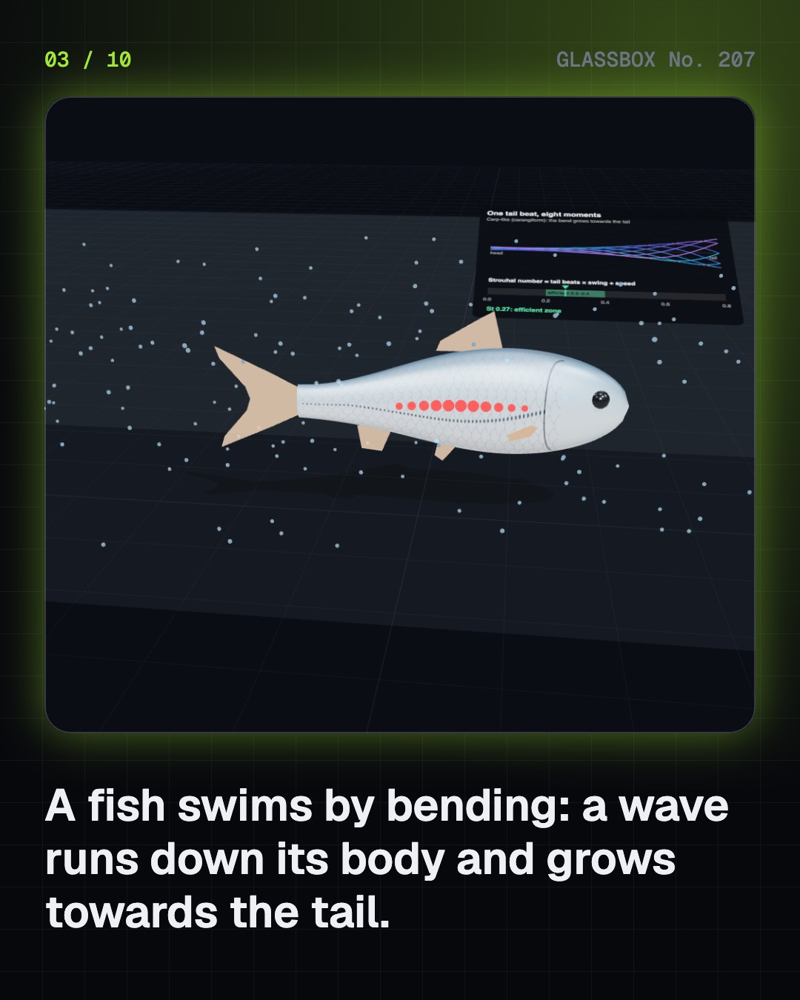
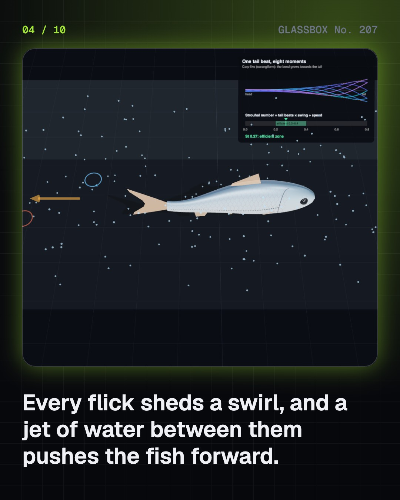

<!-- glassbox:start -->
<!-- Generated from glassbox.json by the Glassbox hub (npm run readme -- fishswimclear). Edit glassbox.json, not this block. -->
<p align="center"><a href="https://glassbox.how/e/fishswimclear/"></a></p>

<h1 align="center">FishSwimClear</h1>

<p align="center"><b>How do fish swim?</b><br>A fish never paddles: it bends. Watch a wave run down a rohu's body, see the swirls its tail leaves behind, and find out how a bag of gas lets it hang still in the water.</p>

<p align="center"><a href="https://glassbox.how/fishswimclear/"><b>▶ Play with it</b></a> &nbsp;·&nbsp; <a href="https://glassbox.how/e/fishswimclear/">Read the 60-second explainer</a> &nbsp;·&nbsp; <a href="https://glassbox.how/fishswimclear/glassbox/reel.mp4">Watch the 40-second video</a></p>

<p align="center">
  <a href="https://glassbox.how/e/fishswimclear/"></a>
  <a href="https://glassbox.how/e/fishswimclear/"></a>
  <a href="LICENSE"></a>
  <a href="LICENSE-CONTENT.md"></a>
  <a href="#privacy"></a>
</p>

## In 60 seconds

1. **Most of a fish is muscle.** A fish's body is mostly swimming muscle, cut into W-shaped blocks called myomeres along a bendy backbone. A thin strip of red muscle cruises all day; the pale white bulk is for sprints. Fins steer and brake, a swim bladder holds gas, and a lateral line feels the water.
2. **A wave runs down the body.** Muscles shorten one block after another, first on one side, then the other. A bend runs from head to tail, growing as it goes, and pushes water backwards, leaving a trail of swirls, so the fish moves forwards. Efficient swimmers keep tail beats times tail swing divided by speed, the Strouhal number, between about 0.2 and 0.4.
3. **A bag of gas to hang still.** Fish flesh is a little denser than water. A swim bladder of about 7% of the body makes a river fish weigh nothing in water; about 5% is enough in the denser sea. Sharks have no bladder: an oily liver and swimming keep them up. Pectoral fins brake and turn, and a giant nerve cell fires the lightning C-start escape.
4. **India's fish.** Catla, rohu and mrigal share Indian ponds by feeding at the top, middle and bottom. Hilsa swim up the Ganga in the monsoon, and the Farakka barrage cut that run from 1975. Mudskippers in the Sundarbans walk on their fins.
5. **Fish and people.** A fish stock gives the biggest steady catch when it is kept at about half its natural size. India rests its seas for 61 days a year during the breeding season, and fish passes help fish climb past dams.
6. **How we found out.** Breder sorted swimming styles in 1926, Gray filmed eels in 1933 and posed his dolphin paradox in 1936, Lighthill wrote the maths in 1960, and robot fish have tested the ideas since 1994.

## Words worth knowing

| Term | Meaning |
|---|---|
| **Myomere** | One W-shaped block of a fish's swimming muscle; there is one for each vertebra. |
| **Red and white muscle** | Red muscle is a thin, tireless strip for cruising; white muscle is the powerful bulk used for bursts. |
| **Body wave** | A bend that travels from head to tail along a swimming fish, growing as it goes. |
| **Strouhal number** | Tail-beat frequency times tail swing divided by speed; efficient swimmers keep it between about 0.2 and 0.4. |
| **Vortex wake** | The trail of alternating swirls a swimming fish leaves, with a backward jet between them. |
| **Swim bladder** | A gas-filled sac that makes a bony fish about as dense as the water around it. |
| **Lateral line** | A row of sense organs along each side that feels water movement and pressure. |
| **C-start** | A fish's fastest escape: a C-shaped bend triggered by a giant Mauthner nerve cell, then a tail flick. |
| **Composite fish culture** | Farming fish that feed at different depths, like catla, rohu and mrigal, in the same pond. |

## A short history

**From Borelli's swimming machines in 1680 to laser-lit swirls, robot tuna and India's hilsa returning past Farakka.**

- **1680** · A book on how animals move (Giovanni Alfonso Borelli, Rome, Papal States)
- **1926** · Swimmers sorted into kinds (Charles M. Breder, New York, USA)
- **1933** · Filming the eel (James Gray, Cambridge, England)
- **1936** · Gray's paradox (James Gray, Cambridge, England)
- **1957** · Carps bred on a farm (Hiralal Chaudhuri and K. H. Alikunhi, Odisha, India)
- **1960** · Fish swimming becomes mathematics (James Lighthill, England)
- **1975** · A barrage across the Ganga (Government of India, Farakka, West Bengal)
- **1994** · RoboTuna swims (Michael Triantafyllou, David Barrett and team, MIT, Cambridge, Massachusetts, USA)

The full story, with 24 moments, charts, people and 34 sources: [glassbox.how/e/fishswimclear/history](https://glassbox.how/e/fishswimclear/history/). The data lives in [`history.json`](history.json).

## Video and slides

Made with the Glassbox studio from this box's storyboard (`window.glassbox.director`). Free to reuse under CC BY 4.0.

<a href="https://glassbox.how/fishswimclear/glassbox/video.mp4"></a>

<p><a href="glassbox/slide-1.jpg"></a> <a href="glassbox/slide-2.jpg"></a> <a href="glassbox/slide-3.jpg"></a> <a href="glassbox/slide-4.jpg"></a></p>

| File | What | Size |
|---|---|---|
| [`glassbox/reel.mp4`](https://glassbox.how/fishswimclear/glassbox/reel.mp4) | Reel / Short, with captions and soundtrack | 1080×1920 |
| [`glassbox/video.mp4`](https://glassbox.how/fishswimclear/glassbox/video.mp4) | YouTube video, with captions and soundtrack | 1920×1080 |
| `glassbox/slide-1…10.jpg` | Instagram carousel | 1080×1350 |
| `glassbox/thumb.jpg` | YouTube thumbnail | 1280×720 |
| `glassbox/cover.jpg` | Share card and repo social preview | 1200×630 |
| [`glassbox/history-reel.mp4`](https://glassbox.how/fishswimclear/glassbox/history-reel.mp4) | “History in 10 moments” Reel / Short | 1080×1920 |
| `glassbox/history-slide-*.jpg` | History carousel | 1080×1350 |
| `glassbox/post.json` | Post copy and schedule used by the publish kit | |

## Privacy

This box has no accounts and no ads, and it ships its own fonts and libraries. When you run it yourself it sends nothing anywhere. On glassbox.how, the site's `/bar.js` also loads Glassbox's analytics: **Google Analytics** to count visits (it asks first in the EU, UK and Switzerland, and stays off when your browser sends Global Privacy Control or Do Not Track) and **ClickTrust** to detect bots.

It remembers a few things **in your own browser only**, and never sends them anywhere:

| Browser storage key | What it holds |
|---|---|
| `fishswimclear.v1` | Which chapters you have opened, your best quiz scores, and sound on or off. |

Exactly what each one sees is at [glassbox.how/privacy](https://glassbox.how/privacy/).

## Licences

- **Code:** [MIT](LICENSE). Use it, change it, ship it.
- **Explanations, text, images and videos** (`glassbox.json`, `glassbox/`): [CC BY 4.0](LICENSE-CONTENT.md). Credit “Glassbox, glassbox.how/e/fishswimclear”.
- **Third-party parts** keep their own licences: [three.js](https://threejs.org) (MIT), [Geist, Instrument Serif](https://openfontlicense.org) (SIL OFL 1.1).
- The Glassbox name and logo aren't covered by either licence. See the [terms](https://glassbox.how/terms/).

Found a mistake? [Open an issue](https://github.com/bdeeps/fishswimclear/issues). Corrections happen in public.
<!-- glassbox:end -->

## Run it

It's plain HTML, CSS and JavaScript. No build step and no dependencies. Run locally, it contacts no other website.

```bash
python3 -m http.server 8000
```

Three.js and the fonts ship in `vendor/` and `fonts/`, so it also works offline.

Then open http://localhost:8000.

## How it's built

| File | What |
|---|---|
| `index.html`, `css/app.css` | The page and its styles |
| `js/app.js`, `js/stage.js`, `js/ui.js`, `js/kit.js` | The shared Glassbox 3D engine: chapters, 3D stage, controls, quiz, video director |
| `js/chapters/*.js` | One file per chapter: the 3D model, controls, text, key terms, quiz and video scenes |
| `js/fish.js` | The bendable fish (skin, muscle, backbone, fins, swim bladder) shared by the chapters, the body-wave, speed and Strouhal model, water specks, the vortex wake and chart boards |
| `glassbox.json` | Title, question, explainer beats, key terms, browser storage and credits shown on glassbox.how |
| `reel` in each chapter | The storyboard the Glassbox studio records into short videos |
| `glassbox/` | The published video, slides, thumbnail and post copy |
| `fonts/`, `vendor/three/` | Self-hosted Geist and Instrument Serif (SIL OFL 1.1) and three.js (MIT) |
